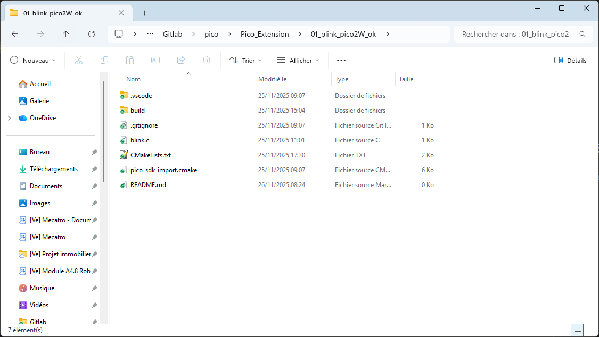
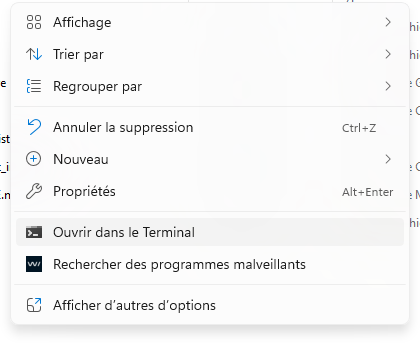
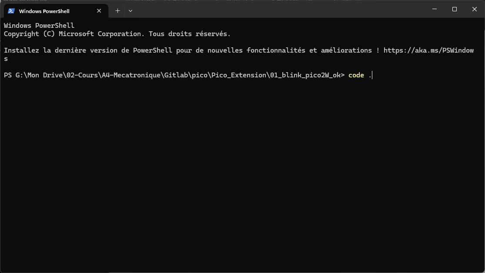
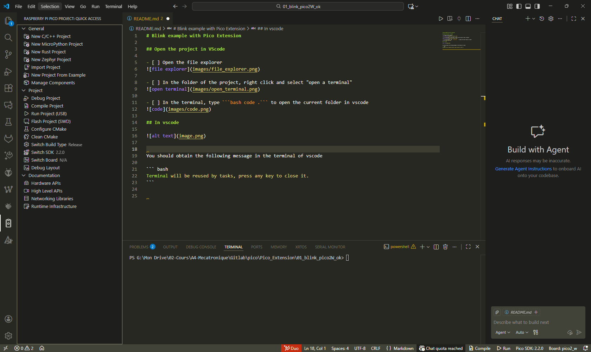
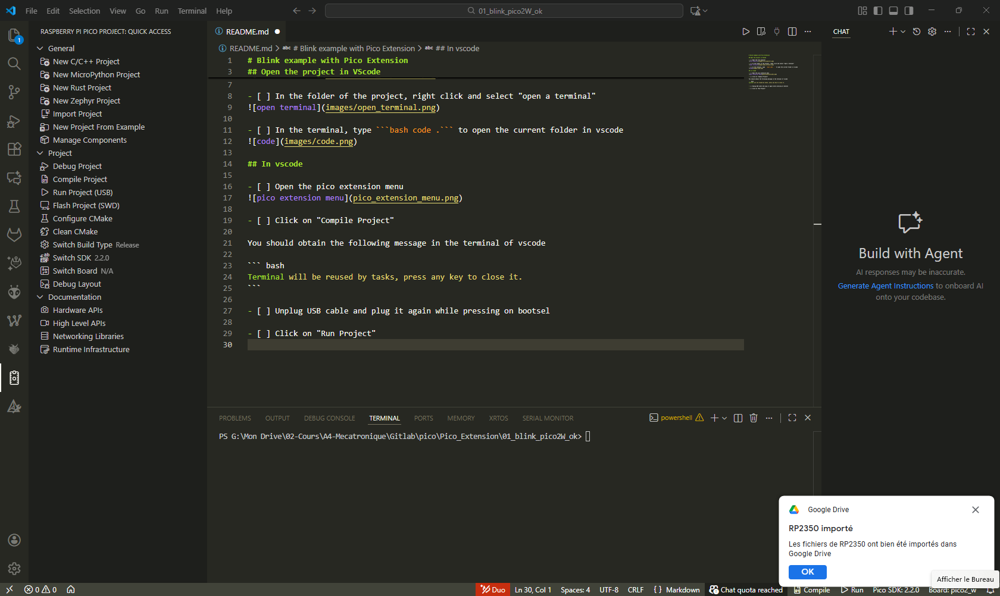
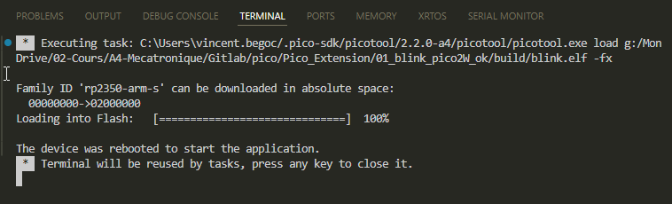

# Faire clignoter la LED intégrée de la Pico

## Introduction

Ce projet est un exemple simple de clignotement de la LED intégrée à une carte Raspberry Pi Pico 2 W.

### Objectifs

Ce programme permet de :

- apprendre à compiler et à téléverser un programme sur une carte Pico ;
- découvrir l’organisation simple d’un projet avec le Pico SDK ;
- commander la LED intégrée à la carte ;
- vérifier que la carte fonctionne ;
- apprendre à documenter un programme.

### Fonctionnement général

Le programme allume puis éteint continuellement la LED intégrée. Chaque état dure 100 ms (ou une autre durée suivant le programme).

## Organisation du projet

Le projet comprend principalement le fichier source `main.c`.

Le fichier `CMakeLists.txt` indique à CMake comment compiler le programme, ajouter les bibliothèques nécessaires et générer les fichiers à téléverser sur la Pico.

Le fichier `pico_sdk_import.cmake` permet d’importer et de configurer le Pico SDK. Il ne faut pas le modifier.

Le dossier `.vscode` contient des fichiers de configuration utilisés par Visual Studio Code et l’extension Pico.

Le dossier `build` est généré par CMake. Il contient notamment les fichiers intermédiaires de compilation et le fichier `.uf2` à transférer sur la Pico.

### Détails du fichier `CMakeLists.txt`

La ligne suivante sélectionne le modèle de carte :

```cmake
set(PICO_BOARD pico2_w CACHE STRING "Board type")
```

La ligne suivante importe le Pico SDK :

```cmake
include(pico_sdk_import.cmake)
```

La commande suivante indique que le projet utilise les langages C, C++ et assembleur :

```cmake
project(blink_project C CXX ASM)
```

La commande suivante ajoute `main.c` à l’exécutable du projet :

```cmake
add_executable(blink_project
    main.c
)
```

Le projet utilise les bibliothèques `pico_stdlib` et `pico_cyw43_arch_none` :

```cmake
target_link_libraries(blink_project
    pico_stdlib
    pico_cyw43_arch_none
)
```

La dernière commande génère les fichiers nécessaires au téléversement du programme :

```cmake
pico_add_extra_outputs(blink_project)
```

### Détails du fichier `main.c`

Les lignes suivantes incluent les bibliothèques utilisées dans le programme :

```c
#include "pico/stdlib.h"
#include "pico/cyw43_arch.h"
```

La fonction `pico_set_led` allume ou éteint la LED intégrée :

```c
void pico_set_led(bool led_state) {
    cyw43_arch_gpio_put(CYW43_WL_GPIO_LED_PIN, led_state);
}
```

La fonction `main` initialise le pilote de la LED, puis alterne entre les états allumé et éteint :

```c
int main() {
    int rc = cyw43_arch_init();
    hard_assert(rc == PICO_OK);

    uint32_t blink_delay_ms = 100;

    while (true) {
        pico_set_led(true);
        sleep_ms(blink_delay_ms);
        pico_set_led(false);
        sleep_ms(blink_delay_ms);
    }
}
```

## Explications techniques

### Configuration matérielle

- une carte Pico 2 W avec LED intégrée ;
- un câble USB.

Sur la Pico 2 W, la LED intégrée est reliée à la puce Wi-Fi. Le programme la commande avec `CYW43_WL_GPIO_LED_PIN` et initialise le pilote correspondant avec `cyw43_arch_init()`.

### Choix de conception

Le programme est volontairement court pour se concentrer sur la commande d’une sortie et sur la structure d’un projet Pico SDK.

La fonction `sleep_ms()` met le programme en attente pendant la durée indiquée. Cette méthode est simple pour faire clignoter une LED mais elle présente l'inconvénient de bloquer l'exécution du programme pendant l'attente.

## Utilisation

### Ouvrir le projet dans VS Code

- [ ] Ouvrir le dossier du projet dans l’explorateur de fichiers.



- [ ] Dans le dossier du projet, faire un clic droit et choisir **Open in Terminal**.



- [ ] Dans le terminal, saisir `code .` pour ouvrir le dossier courant dans VS Code.



Vous pouvez également ouvrir le dossier depuis VS Code avec **File → Open Folder**.

### Compiler et téléverser le programme

- [ ] Ouvrir le menu de l’extension Pico.



- [ ] Cliquer sur **Compile Project**.

La compilation terminée, le terminal de VS Code affiche un message indiquant que le terminal sera réutilisé par les tâches.

- [ ] Débrancher le câble USB, puis le rebrancher en maintenant le bouton **BOOTSEL** de la carte enfoncé.

Un nouveau lecteur correspondant à la mémoire de la Pico doit apparaître.



- [ ] Dans le menu de l’extension Pico, cliquer sur **Run Project**.



## Tests et validation

Ce code a été validé le 22/10/2026 avec la version "2026_10_22 version doc FR".

Après le téléversement, la LED intégrée de la Pico doit clignoter : elle reste allumée 100 ms, puis éteinte 100 ms, et recommence.

## Améliorations possibles

- [ ] Modifier la durée d’allumage et d’extinction de la LED pour changer sa fréquence de clignotement.
